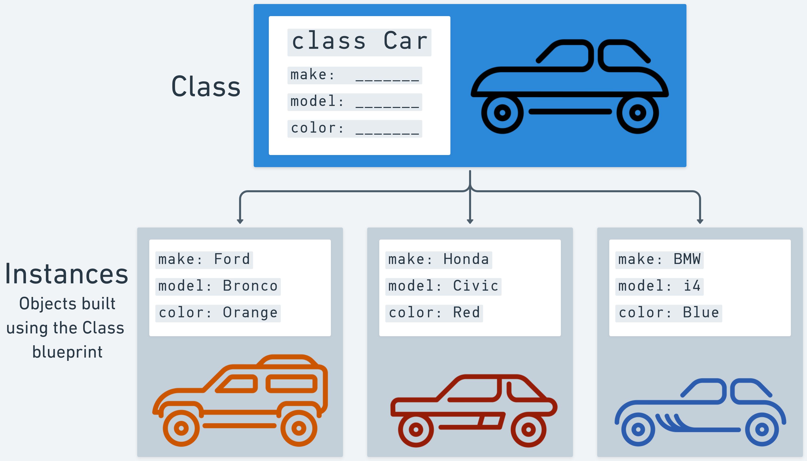

# 

**Learning objective:** By the end of this lesson, students will understand the concept of classes in JavaScript.

## What are classes?

In JavaScript, classes are act as blueprints for creating new objects. These new objects are called *instances* of that class. In [object-oriented programming (OOP)](https://en.wikipedia.org/wiki/Object-oriented_programming), we use objects to model our application's purpose.



> 📚 An *instance* is an object produced by a class, containing all of the properties and behaviors defined by that class.

## Why use classes?

Objects can be created using object literal notation, so why are classes necessary?

Continuing from our example above - imagine we are building an application for a car dealership. We want to track their inventory of cars and make modifications over time. We can't possibly know the make, model, and color of every car that the car dealership will ever sell when we build the application. 

Without classes, we would have to add a new object literal in the application's code every time the dealership buys a new car. A more efficient approach can be taken with classes. We can construct a `Car` class that defines the basic structure of a car. In this example, every instance of a car has a `make`, `model`, and a `color`.

## Encapsulation in OOP

[Encapsulation](https://en.wikipedia.org/wiki/Encapsulation_(computer_programming)) is a key principle of Object Oriented Programming. Encapsulation is the concept of bundling data (properties/attributes) and related behavior (methods) **within an object**.

Let's build on this idea using the cars in the example above. Each car object has three attributes:

1. `make`
2. `model`
3. `color` 

It makes sense to group (encapsulate) these attributes together because they collectively describe characteristics of the same entity: a car.

Here is how those properties might be represented in an object:

```js
const hybridCar = {
  make: 'Toyota',
  model: 'Prius',
  color: 'black',
};
```

## What other attributes might a car have?

What about the **behavior** of a car? What can a car do? What can you do with a car? Let's start with the basics - a car needs to start, right? A `start()` method will do nicely then.

As you add behaviors you may also decide to create new attributes for a car - a `start()` method won't help us much unless we're also tracking if a car is currently running, so we should also create an `isRunning` attribute to support that behavior. Let's add those onto our object from above:

```javascript
const hybridCar = {
  make: 'Toyota',
  model: 'Prius',
  color: 'black',
  isRunning: false,
  start: function() {
    hybridCar.isRunning = true;
    console.log('Running!');
  },
};
```

> ❓ What other methods might a car have? Would new attributes need to be added to support those methods?