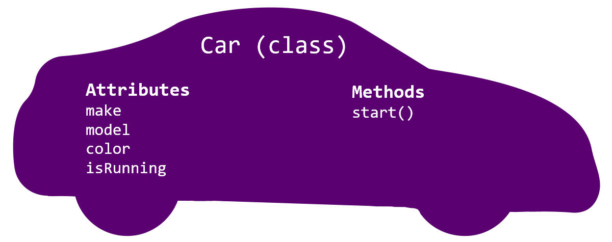

# 

**Learning objective:** By the end of this lesson, students will be able to define and instantiate classes in JavaScript.

## Defining a class



In JavaScript, we define a class using the [class](https://developer.mozilla.org/en-US/docs/Web/JavaScript/Reference/Statements/class) keyword:

```js
class Car {
  // Code to define the class's properties and methods
};
```

Take a look at the syntax used above. It might remind you of the syntax used for defining functions, and rightly so, as classes in JavaScript are essentially special types of functions. However, there are some notable differences between the two, particularly in their naming conventions. Classes are typically written using *PascalCase* (capitalizing the first letter of each word), whereas functions are often written in *camelCase* (starting with a lowercase letter and capitalizing each subsequent word).

> 🧠 Although we haven't added any properties or methods to the class, we can still create an object (instance) from it, though it wouldn't be particularly functional or useful.

## Instantiating a class

The term **instantiation** refers to the process of creating a new object from a class. This newly created object is known as an **instance**. When we instantiate a class, the instance we create inherits all the properties and behaviors defined in that class.

In JavaScript, instances are created using the `new` keyword, followed by the name of the class.

Let's create a `myCar` object:

```js
const myCar = new Car();
```

> 💡 Notice how instantiating a class resembles calling a function, using the `new` keyword, followed by the class name and parentheses.

### The `constructor` method

When a class is instantiated, its [constructor](https://developer.mozilla.org/en-US/docs/Web/JavaScript/Reference/Classes/constructor) method is called **automatically**. The `constructor` is a special method defined within the class.

In the `constructor` method, you can **define the initial values for the object's properties**. These properties are attached to the object using the `this` keyword:

```js
class Car {
  constructor(make, model) {
    this.make = make;
    this.model = model;
    // return is not needed
    // because the new object is returned by default
  }
};
```

In this example, `make` and `model` are parameters passed to the `constructor` and are used to set the initial values of the `make` and `model` properties on each new `Car` instance.

Now when we create a new instance, we can define its initial values by passing arguments to the `constructor`:

```js
const myCar = new Car('Ford', 'Bronco');
console.log(myCar); // { make: "Ford", model: "Bronco" }
```

Not every property of a class requires a parameter in the constructor. If a property should have the same default value for every instance, you can directly assign it within the constructor.

For example, let's make sure a car isn't running when we build it:

```js
class Car {
  constructor(make, model) {
    this.make = make;
    this.model = model;
    this.isRunning = false; // default to false
  }
};
```

With this setup, every `Car` instance we create will have `isRunning` set to `false` by default, without needing to pass this as a parameter to the constructor everytime.

### What is `this`?

**`this` is a keyword in JavaScript** available for use inside of functions/methods (like our `constructor` above). The `this` keyword is a part of a function's **execution context**, which includes the code and everything that aids in its execution.

The mechanism provided by `this` is necessary for all object-oriented programming languages to:

1. **Provide access to an object's properties and methods** from other methods within that object
2. **Implement code reuse**

`this` has its value automatically set by the JavaScript engine when a function is invoked. This setting of a value is also known as *binding*. However, even though we **can** change the value of `this`, doing so is not common, so we'll focus on learning the rules that JavaScript uses to set `this` automatically. Some of these rules are explained below.

### Object instantiation - behind the scenes

When we invoke the class prefaced with the `new` keyword, behind the scenes:

- JavaScript creates a shiny new empty object and assigns it to the `this` keyword when calling the `constructor` method.
- The `constructor` method is called with the arguments we provided when invoking the class. Remember, the `constructor` method is where we create/initialize properties on the new object assigned to `this`.
- After executing the `constructor`, the class automatically returns the shiny new object.

Although the `constructor` method is notable because it's called automatically, there's nothing special about how it's defined; other methods are defined the same way.

Don't worry if this is hard to grasp at first; `this` is a difficult concept - we'll return to it later in this lecture when we can provide a more concrete example. For now, what's most important to remember is that **`this` in the `constructor` function refers to the shiny new object being made whenever it is run! In this context, `this` is necessary because we can't know the object's name ahead of time.**

### 🎓 You Do 

Add another property, and instantiate the class.

1. Modify the `Car` class by adding a property named `color`. Don't forget to add a new parameter to the `constructor` method.

2. Test it by instantiating another object of your choice. It should resemble the one below - you should add this line to your code as well; we'll use it later in this lesson.

    ```js
    const mySubaru = new Car('Subaru', 'Crosstrek', 'blue')
    ```