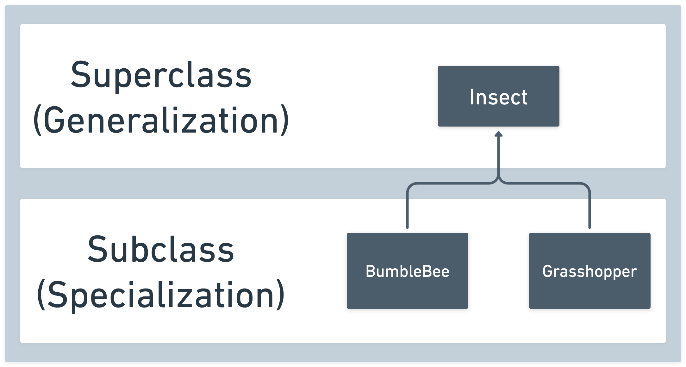
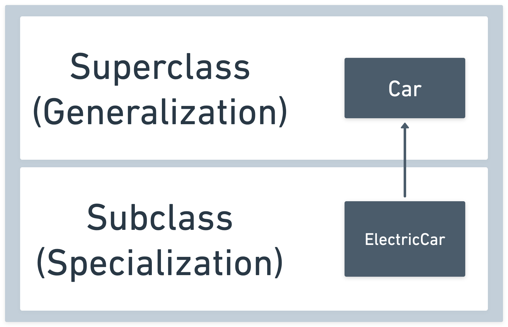

# 

**Learning objective:** By the end of this lesson, students will understand the concept of inheritance in Object-oriented programming.

## What is inheritance?

In OOP, inheritance is the mechanism through which a new class automatically receives properties and methods from an existing class, enabling it to reuse and extend the inherited code.

The newly derived class can be specialized by:

- Adding additional properties.
- Adding additional methods.
- Overriding existing methods.

> 📚 The newly derived class is called a *derived* or *subclass* while the original class is called a *base* or *superclass*.

A subclass automatically inherits all of the superclass's properties and methods - whether you want them all or not.



Above, the `Insect` superclass has the `BumbleBee` and `Grasshopper` subclasses derived from it. The diagram follows the guidelines of the [Unified Modeling Language's class diagram](https://en.wikipedia.org/wiki/Class_diagram) specifications, albeit in a simplified form.

We're going to add a subclass called `ElectricCar` that will be derived from the `Car` superclass! Here's a diagram showing the relationship we will create.



## Using the `extends` keyword to create a subclass

We use the `extends` keyword to define a subclass.

```js
class ElectricCar extends Car {
  constructor(make, model, color, batteryCharge) {
    super(make, model, color);
    this.batteryCharge = batteryCharge;
  }
};
```

In a derived class, the [super](https://developer.mozilla.org/en-US/docs/Web/JavaScript/Reference/Operators/super) keyword represents the **parent superclass** and must be called before the `this` keyword can be used in the constructor. It can also be used to access properties of the superclass.

Additional properties like `batteryCharge` above can be initialized in the `constructor`. Instances of `ElectricCar` will have a `batteryCharge` property, while instances of `Car` will not. Let's build an electric car!

```js
const myVolvo = new ElectricCar('Volvo', 'EX30', 'Gray', 100); // Fully charged!
```

Determining which classes in a hierarchy to attach properties and methods to is difficult work, full of pitfalls and gotchas. This is one of the biggest hurdles to overcome when you're getting started with inheritance - it won't always be as clear-cut as it is above!

## Overriding methods

A derived class can also override methods defined on the parent superclass. Let's use this principle to modify the inherited `start` method for the `ElectricCar` class:

```js
class ElectricCar extends Car {
  constructor(make, model, color, batteryCharge) {
    super(make, model, color);
    this.batteryCharge = batteryCharge;
  }
  start() {
    if (this.batteryCharge > 0) {
      this.isRunning = true;
      console.log('Your electric car is running!');
    } else {
      this.isRunning = false;
      console.log('Time to recharge!');
    };
  }
};
```

Next, we'll start up the electric car, quickly deplete the battery, and try to restart it:

```js
myVolvo.start() // "Your electric car is running!"
myVolvo.batteryCharge = 0
myVolvo.start() // "Time to recharge!"
```